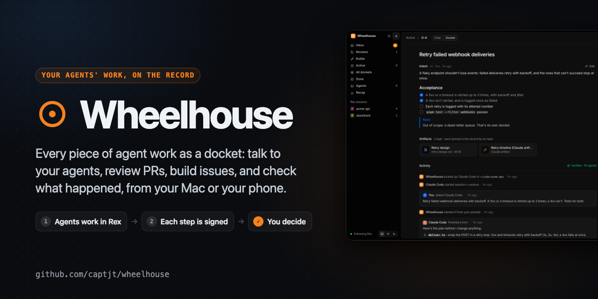
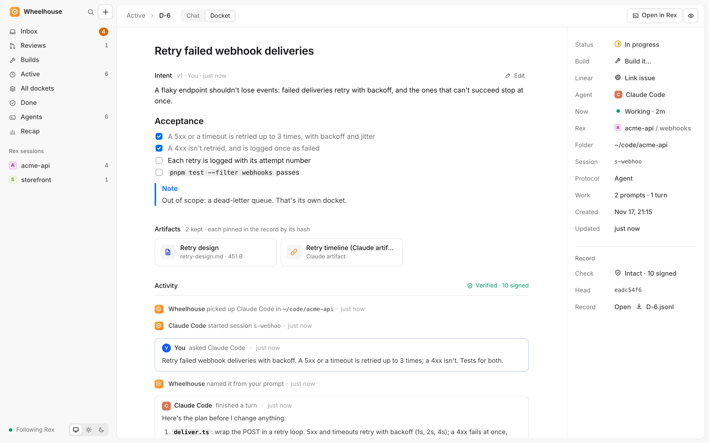
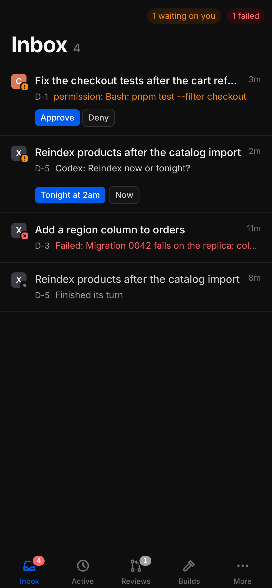
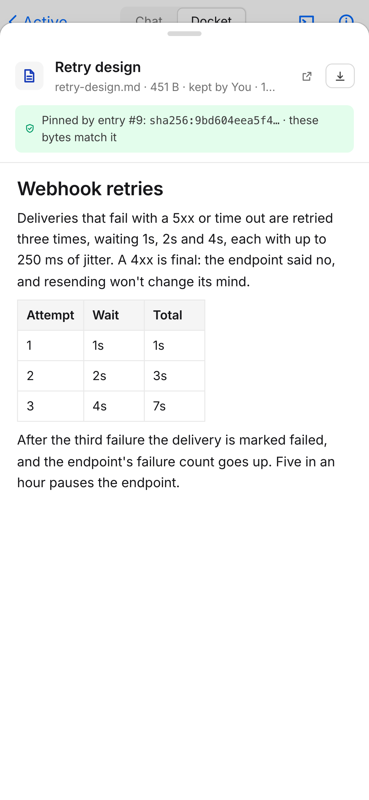

# Wheelhouse



Every piece of agent work as a docket, on a record you can check.

Wheelhouse follows [Rex](https://www.superlogical.com/rex). Every Claude
Code or Codex agent running in a Rex pane gets a **docket**: what you asked,
what the agent answered, when it waited on you, the files it made, and how
it ended. Each entry is signed and chained, so `wh verify` shows that
nothing in a docket's record was changed, removed or reordered.

On top of the record, Wheelhouse runs the work you'd otherwise babysit:

- **Inbox.** What needs you, from every agent: a permission prompt to
  approve, a question with your answers as buttons, a failure, a finished
  turn, a review ready to post.
- **Chat.** Talk to any agent from your phone. What you send while it
  works waits and goes in when its turn ends; its reply comes back as a
  push.
- **Review.** A PR that asks you for a review gets blind reviewers, a
  checker that merges their drafts and rates the merge risk, and a post
  you approve. The round's reports stay with the docket.
- **Build.** A docket's intent becomes a PR: a builder plans and builds, a
  checker checks, and you approve the plan and the PR before anything
  reaches GitHub.
- **Recap.** What happened today, this week, or in 30 days, as a standup
  note.

<table>
  <tr>
    <td></td>
    <td></td>
  </tr>
</table>

<p align="center">
  
  
  
</p>

> Rex is in private beta. Wheelhouse needs a Rex build whose agents report
> program status (OSC 7501): Claude Code and Codex do on their own.

## Requirements

- macOS and [Rex](https://www.superlogical.com/rex), with the `rex` CLI
- [Rust](https://rustup.rs) 1.88 or later, [Node](https://nodejs.org) 22.18
  or later, and [just](https://github.com/casey/just) (`brew install just`)
- [LuaJIT](https://luajit.org) (`brew install luajit`), to read
  `review.lua` and `build.lua`
- [GitHub CLI](https://cli.github.com), signed in (`gh auth login`), for
  Review and Build
- Claude Code, and Codex if you want it as a reviewer or builder
- Optional: [Tailscale](https://tailscale.com) with HTTPS on, for the app
  on your phone and Web Push; `terminal-notifier`, for clickable Mac
  notifications; a Linear API key, for linking issues

## Install

```sh
git clone https://github.com/captjt/wheelhouse ~/src/wheelhouse
cd ~/src/wheelhouse
just setup
```

`just setup` builds the app and the hub (`wh`, in `~/.cargo/bin`), runs the
hub at login as a LaunchAgent (`wh up`; logs with `wh logs`), installs
Claude Code's hooks (names from your prompts, turns with their last
message, a new docket on `/clear`), and installs the `wheelhouse` skill for
agents. Run it again after pulling to update.

Then:

1. Open http://127.0.0.1:7500. Every agent pane in Rex is already a docket.
2. Tell your agents about Wheelhouse: paste the block in
   [docs/agent-instructions.md](docs/agent-instructions.md) into
   `~/.claude/CLAUDE.md` (and `~/.codex/AGENTS.md`).
3. Optional, the phone: `wh web --publish` serves the app on your tailnet
   at `https://<your-mac>.ts.net:7500`, to your Tailscale user only. Open it
   in Safari and add it to your Home Screen for the app and its
   notifications.
4. Optional, Linear: `wh setup-linear` stores a read-only API key in the
   Keychain.

## Review and Build

Both are off until you set them up.

- **Review:** copy [examples/review.lua](examples/review.lua) to
  `~/.config/wheelhouse/review.lua` and list your repos and their
  checkouts. `wh review on` checks it and turns Review on, paused;
  `wh review resume` starts it. Each PR that requests you becomes a Review
  docket. See [docs/review.md](docs/review.md).
- **Build:** copy [examples/build.lua](examples/build.lua) to
  `~/.config/wheelhouse/build.lua`. Press **Build it** on a docket with an
  intent, or `wh build start D-12`. See [docs/build.md](docs/build.md).

Only the hub writes to GitHub, with your `gh` login, and only what you
approved: agents' panes have no GitHub token, and their pushes fail.

## Commands

| | |
| --- | --- |
| `wh`, `wh ls [--all]` | What needs you, and what's in flight |
| `wh show D-4` | One docket's record, each entry with how it's known |
| `wh new "title"`, `wh new --linear ENG-142` | Open a docket by hand, or from a Linear issue |
| `wh note D-4 "text"`, `wh set D-4 --title … --status done` | Add a note; rename, or set the status |
| `wh intent D-4 [TEXT\|-]` | Print a docket's intent, or set it |
| `wh link D-4 ENG-142` | Link a Linear issue |
| `wh attach FILE\|URL [--title T] [--docket D-4]` | Keep a file (pinned by its hash) or a link with a docket |
| `wh start [--codex] [-C DIR] "prompt"` | Start an agent on a new docket, in Rex |
| `wh verify [D-4]`, `wh export D-4 > D-4.jsonl`, `wh verify --file D-4.jsonl` | Check a record, every kept file included; one that checks without the hub |
| `wh review`, `on`, `off`, `pause`, `resume`, `check` | The Review protocol, and its switches |
| `wh review post-mode ask\|auto\|config` | Who posts a checked review: you, or the checker |
| `wh review pickup\|preview\|post\|dismiss OWNER/NAME N` | Review a PR that didn't ask; a round's checked review |
| `wh build`, `wh build start D-12\|owner/name#45\|ENG-142`, `discard`, `pause`, `resume` | The Build protocol |
| `wh recap [today\|week\|30d]` | What happened, as Markdown |
| `wh up`, `down`, `logs`, `status` | The hub at login; its log; what it sees |
| `wh web [--publish]` | The app's address on your tailnet |
| `wh hooks [install\|remove]`, `wh skill [install\|remove]` | Claude Code's hooks; the agents' skill |
| `wh setup-linear` | Store a Linear API key in the Keychain |
| `wh import rex-reviewer` | Move over from rex-reviewer, once |

Agents use `wh` from their panes too: `brief`, `intent`, `note`, `attach`,
`send`, `reply`, `inbox`, `read`, `wait`, `name`, `whoami` and `share`. The
skill (`wh skill`) teaches them how.

## The app

| Keys | |
| --- | --- |
| `⌘K`, `/` | Search dockets and commands |
| `C` | New docket |
| `G` then `I`, `A`, `D`, `X`, `N`, `R`, `B`, `P` | Inbox, Active, All, Done, Agents, Reviews, Builds, Recap |
| `J`, `K`, `↩`, `Esc` | Move, open, back |
| `S`, `R`, `M`, `O` | Status, rename, note, the agent's pane |

On a phone it's laid out natively: a tab bar, a docket that slides onto
its list (swipe right to go back), rows that swipe to Done or Status, and
sheets from the bottom. The theme follows your system, or pin Light or
Dark at the bottom of the sidebar.

**The record, readable.** Click **Verified** on any docket to read its
record: who signed each entry, how each is known, and what the check means
(and doesn't). [docs/record.md](docs/record.md) is the format.

## Configuration

Everything has a default. These are for running a second hub, tests, and
odd setups.

| Variable | Default | |
| --- | --- | --- |
| `WH_STATE` | `~/.local/state/wheelhouse` | The record, keys, kept files and socket |
| `WH_HTTP` | `127.0.0.1:7500` | The app (`off` for none) |
| `WH_TAILNET` | `127.0.0.1:7501` | The listener `wh web --publish` serves (`off` for none) |
| `WH_SOCKET` | `$WH_STATE/wh.sock` | The CLI's and hooks' socket |
| `WH_REVIEW_CONFIG`, `WH_BUILD_CONFIG` | `~/.config/wheelhouse/review.lua`, `build.lua` | The protocols' configs |
| `WH_NOTIFY` | on | `off`: no Mac notifications or Web Push |
| `WH_REX`, `WH_GH`, `WH_LUAJIT`, `WH_TAILSCALE` | found on PATH | The tools the hub runs |
| `WH_LINEAR_KEY` | the Keychain | A Linear API key |
| `WH_WEB_DIR` | built in | Serve `web/dist` from disk, to iterate on the app |

## How it works

- **The hub** (`wh serve`) follows Rex's events and mirrors its sessions,
  panes and each agent's program status. An agent pane gets a docket;
  Claude Code's hooks add your prompts and its turns.
- **The record** is SQLite: one signed, chained entry per thing that
  happened, and each docket's state folded from its entries. Files are kept
  once, by hash. Keys are Ed25519, one per signer, on this Mac.
- **The app** is React, built into the binary and served by the hub, on
  your Mac and (through Tailscale) your phone. Live updates come over
  server-sent events.
- **Review and Build** run agents in Rex panes of their own, with a wall
  around them, and keep their working state per PR or docket.

[DESIGN.md](DESIGN.md) has the why. [docs/roadmap.md](docs/roadmap.md) has
what's next.

## Security

Agents run as you, on your Mac. Wheelhouse keeps their mistakes off GitHub
and out of the app, but it isn't a sandbox against a hostile agent.
[docs/security.md](docs/security.md) says what it protects and what it
doesn't.

## Develop

```sh
just check          # what a pull request needs to pass
just dev            # the web app with hot reload on :5180, against a running hub
just screenshots    # the README's images, from a made-up world
```

[CONTRIBUTING.md](CONTRIBUTING.md) covers a second hub to try changes on,
where things are, and the house style.

## License

MIT. See [LICENSE](LICENSE).
