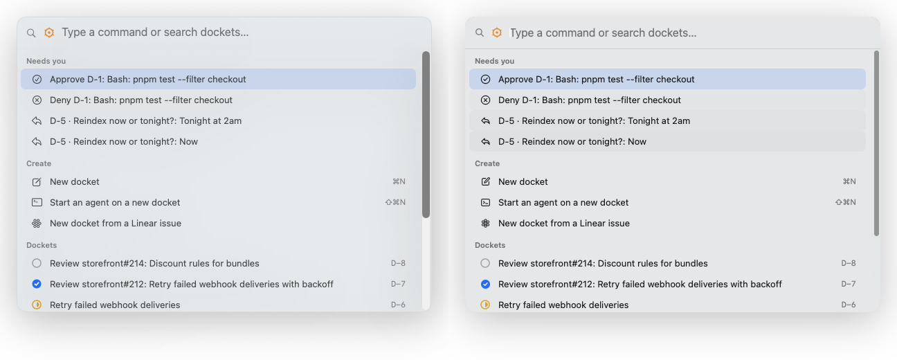
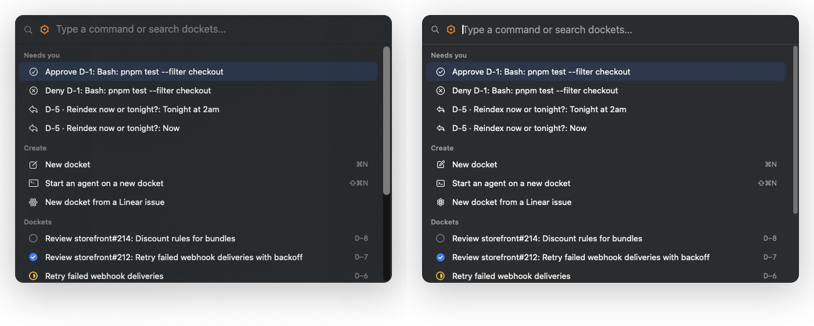
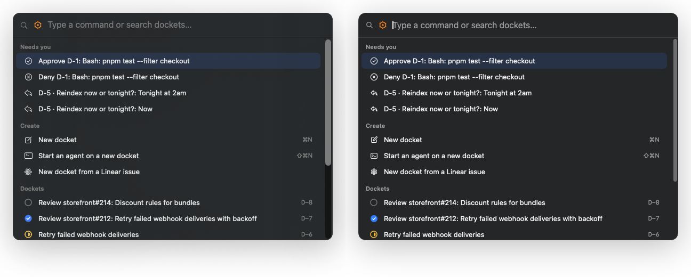

# Rune: a trial on `dev/rune`

[Rune](https://github.com/anomalyco/rune) is a GPU-rendered Rust UI framework
(macOS, Windows, Linux, and an experimental web target) from Anomaly, the
OpenCode team. This branch tries it on one Wheelhouse surface to decide
whether, and where, it belongs in Wheelhouse. Nothing here replaces
Wheelhouse.app (SwiftUI) or the web app (React). The docket's intent holds the
acceptance items; this page holds the context and the rules.

## What Rune is (November 2026)

- Rust views (`fn view(&State, &mut Cx) -> El`), Taffy flexbox, analytic
  springs on every property, one instanced draw call a frame, its own text
  stack tuned to match CoreText pixel for pixel. Native means compiled and
  GPU-drawn, not system controls: Rune draws its own, close to macOS's.
- **Agent tooling built in:** any app runs headless with `--snap out.png`,
  `--tree tree.json` (the element and accessibility tree), `--script` input
  replay, and `--video`. That is what our SwiftUI `--snapshot` mode and the
  Chrome screenshots do by hand.
- Accessibility through AccessKit (VoiceOver, Voice Control). Multiple
  windows, panels and overlays, global shortcuts, `on_open_url`, context
  menus, drag in and out, rich text editing, streaming Markdown (rune-kit),
  Liquid Glass through native views (`system_material`).
- `rune-kit` mirrors `@opencode/ui`: OpenCode, a coding-agent app like
  Wheelhouse, is being ported onto it, so chat, diffs and sidebars get real use.
- **Maturity:** created 2026-10-22, MIT, no releases. Consumers pin a `dev`
  rev, and patch winit, wgpu-hal, parley and AccessKit with Rune's own forks
  at that rev. 15 to 37 commits a day, two main authors, 460 open issues. No
  pull requests: issues only.

## Against what Wheelhouse uses

| Wheelhouse needs | Rune today |
| --- | --- |
| The phone (the web app on iPhone) | Web target experimental (one WebGPU canvas); its docs say real iPhone keyboard, dictation, autocorrect and Safari WebGPU aren't verified. iOS comes after web, Android after that. |
| Notifications with Approve, Deny, a reply | `rune-notify` posts, withdraws and reports clicks; no actions |
| The menu bar item and its panel | The app owns its tray; Rune gives compact windows and handles |
| Quick Look for kept files | None |
| ⌥⌘K from any app, a floating panel | Global shortcuts, panels and overlays: there |
| VoiceOver | AccessKit: there |
| System controls (DESIGN.md decides "the system's own controls") | Rune draws its own: a design change, Jordan's call |

## The trial

The ⌥⌘K quick panel, rebuilt in Rune against the hub's API: what needs you
(approve, deny, an agent's options), Create, and docket search. It's small,
it's text-input heavy (the riskiest area in any GPU UI), and the SwiftUI one
is there to compare with, on the same data.

Done, in `rune/` ([its README](../rune/README.md)): Rune pinned at `dev`
78efd4a (2026-11-18) with its five patched crates. The panel lists what needs
you in the Inbox's order, Create (a docket, an agent on a new docket, a docket
from a Linear issue), the first eight dockets, and searches them all with the
SwiftUI palette's scoring; Return on a docket opens it in the web app. It
follows the hub's events, and refuses the daily hub on :7500.

## Running it beside your daily Wheelhouse

The Wheelhouse you work in (the LaunchAgent hub on 127.0.0.1:7500,
`~/.local/state/wheelhouse`, `~/.cargo/bin/wh`, `~/Applications/Wheelhouse.app`)
is never touched from this branch:

- **Its own worktree** (`~/git/captjt/rex-hub-rune`, branch `dev/rune`), its
  own `target/`. `main` stays checked out in `~/git/captjt/rex-hub` for daily
  fixes; this branch merges `main` in as it moves.
- **Its own Cargo workspace** in `rune/`, so Rune's pinned rev and its patched
  crates never reach the hub's `Cargo.lock`, and `just check` on the hub
  doesn't build Rune.
- **Its own hub: the made-up world.** `PORT=7458 scripts/screenshots.sh
  --serve` runs a hub with its own HOME, a stand-in Rex and gh, at
  http://127.0.0.1:7458. The Rune app reads `WH_HUB` (default that world) and
  must never write to 7500.
- **Its own identity:** binary `wheelhouse-rune`, bundle id
  `dev.wheelhouse.rune`, no `wheelhouse://` scheme, and ⌃⌥⌘K instead of ⌥⌘K
  so it never takes the installed app's shortcut.
- **Never from here:** `just install`, `just app`, `just setup`, `wh up`,
  `wh down`, `cargo install`, `wh hooks install`, `wh skill install`.

## Findings

Measured on the M2 Max, with other agents keeping the load between 12 and 50,
so build times are a little high; the comparison is what counts.

### Beside the SwiftUI panel

The SwiftUI shots are its own `--snapshot` (`--only quick`), the Rune ones on
the same world straight after, both with `-AppleShowScrollBars Always`. Left
SwiftUI, right Rune.

| | Light | Dark |
| --- | --- | --- |
| On screen (Rune's native material) |  |  |
| Headless (`--snap --scale 1`: a fill stands in for the material) |  |  |

- **Layout and text are the same to the pixel.** Every row, header and edge
  lines up at 1x, and text ends where SwiftUI's does ("Approve D-1: Bash: pnpm
  test --filter checkout" stops at x = 356 in both): SF Pro through
  `Family::Named("System Font")`, laid out by Rune to match CoreText.
- **The material took work.** Rune has two (`Glass`, `Popover`); Popover is
  far lighter than `.regularMaterial` in dark (#5d5f62 against #26282b here),
  so the panel lays a tint over it. The material follows the app's
  NSAppearance, which Rune has no API for: the Theme commands set
  `NSApp.appearance` through objc2 themselves.
- **Legacy scroll bars:** Rune's core draws no scroll bar; rune-kit's follows
  "Show scroll bars" (and the `-AppleShowScrollBars` argument), but under
  Always it's an overlay thumb over the rows. The panel gives it AppKit's
  15 pt gutter and a darker thumb; the thumb is still thinner, with no track.
- **No SF Symbols:** the marks are redrawn as SVG. Close, not the same.
- **Controls are Rune's own** (the Create forms' buttons and the agent
  picker), not the system's: DESIGN.md's call, unchanged.

### Against the made-up world

Each of the panel's writes, scripted (`rune/scripts/approve.json`,
`answer.json`, `create.json`) and read back from the hub: approve and deny
reach D-1's record (the world's stand-in pane never clears, so the hub answers
"Sent, but the prompt is still showing", as it would to the SwiftUI panel);
choosing "Tonight at 2am" answers the ask; New docket made D-9 with its note.
Live: with the panel running, an ask answered elsewhere leaves it, and a new
one arrives, each on the hub's next event (`WH_RUNE_LOG=1` shows every state
that lands).

### Text input and IME

Checked headlessly with `rune/scripts/edit.json`, reading the field from
`--tree` at each mark: typing, Backspace, the caret moved back and a letter
put in the middle, ⌘A then typing over it, ⌘Z bringing the text back
selected. Then an input method: the composition draws underlined
([still](images/rune/ime.png)), the list doesn't filter on it, Return during
it goes to the input method rather than running a command, and the commit
lands (日本). On screen, setting the field through the accessibility API (as
Voice Control does) types into it and filters the list. Typing with a real
keyboard and input method is the check left by hand.

### VoiceOver

`--tree` gives a text field "Search Wheelhouse" whose active descendant is the
selected row; a listbox "Commands and dockets" with its size; level-2
headings for the groups; and options with their position, selected state, a
description (the group, or a docket's status) and their shortcut. The live
app, read through the AX API (`rune/scripts/ax-tree.swift`, what VoiceOver
asks), agrees: AXTextField, AXList, AXHeading, and the rows as AXStaticText
with selected and focused following the arrow keys. In the SwiftUI code the
rows are tap gestures on a stack with no accessibility modifiers: no list,
selection or headings (read from Palette.swift, not from its live tree). Two things found and fixed on the way:
a `role("dialog")` card reached VoiceOver as a second AXWindow inside the
panel's, and shortcut hints were read twice. One quirk: the first query after
the panel shows answers an empty tree for up to a second while AccessKit
builds it. Listening to VoiceOver itself is the check left by hand.

### Checking it headlessly, as an agent

The strongest part. Every check above ran without a window, a display or
Screen Recording permission: `--snap` light and dark at 1x and 2x, `--tree`
with the accessibility tree, `--script` with keys, chords and IME events, and
`--video` with keycaps: [answering the ask](images/rune/answer-light.mp4)
([dark](images/rune/answer-dark.mp4)), which answers it on the world for real
(`rune/scripts/ask.sh` poses it again). It found my own bugs: a list that
couldn't scroll (its rows' column shrank to the viewport, so the scroll bar
had zero height) showed up in `--tree` before any screenshot did. Scripts
are on a virtual clock, so the app makes its hub calls inline in a headless
run; answers from a worker thread would land on whatever frame wall time
reached. The SwiftUI panel's `--snapshot` needs real windows and Screen
Recording, and can't drive input.

On screen is harder: a launcher panel takes the keyboard when it shows, so
captures and traces need the person away, or their OK.

### Numbers

| | Rune panel | SwiftUI |
| --- | --- | --- |
| Cold release build | 93 s (534 s CPU) | 68 s, fetching its packages too |
| Release, after a one-line change | 10.7 s | 45 s (whole-module) |
| Cold debug build | 51 s | 27 s |
| Debug, after a one-line change | 1.3 to 2.7 s | 2.2 s |
| Binary | 23.3 MB stripped (27.9 MB; 31.7 MB with the agent tooling) | 11.3 MB, the whole app |
| Frame CPU in a window, under motion (120 Hz) | p50 1.9 ms, p95 2.7 ms | no trace to compare without Instruments |
| Presents | every 8.3 ms; 6% one refresh late, none later | |
| Frame CPU headless (`answer.json`) | p50 0.16 ms, p95 2.5 to 3.0 ms | |
| Memory | 21 MB footprint, hidden or shown | 111 MB, the whole app |
| Idle | 0% CPU: nothing drawn at rest | |
| Code | 1,674 lines: its own hub client, model and view | 564 (QuickPanel.swift, Palette.swift), on the app's Store and models |

Rune's README gives 9.3 MB stripped for its example app; the rest here is
rune-kit (pulled in for its scroll bar, with its syntax lexers), ureq,
serde_json and objc2-app-kit. I didn't break it down further.

### Moving to a newer Rune

`dev` hadn't moved past the pin by the end (0 commits), so I measured the
week before it instead: the panel built at d9b45a5 (2026-11-11, 436 commits
earlier), then moved to the pin with `rune/scripts/bump-rune.sh`. The source
needed nothing. The manifest needed four new `[patch]` entries (winit,
parley_engine and both AccessKit adapters joined wgpu-hal that week; the
script stops and names them) and two new feature names (agent tooling became
opt-in for release builds). The rebuild took 60 s, and the tests passed.
Cheap this time, but that's one week: 436 commits, no tags, and the patch
table you must copy grew from one crate to five.

## Decision

**Wait, for Rune's first tagged release.** Nothing moves to `main` now.

- **On the Mac it would replace nothing.** The SwiftUI panel looks the same,
  and the Rune one needed workarounds for what SwiftUI has for free (the
  material's weight, the app's appearance, legacy scroll bars, SF Symbols),
  plus its own hub client. A Rune panel inside a SwiftUI app is a second
  process and a 23 MB binary.
- **It isn't ready to stand on.** No release, 436 commits in a week, the
  patches to copy growing, and no pull requests: every gap above is an issue
  to file and wait on.
- **What it would be for:** a native Wheelhouse beyond the Mac (Windows,
  Linux) from one Rust codebase beside the hub's, which agents can check
  headlessly end to end. Rune does that better than anything Wheelhouse has
  now. The phone stays the web app until Rune's iOS target exists, and the
  menu bar app needs notification actions (rune-notify has none) before Rune
  could carry it.

Look again when Rune tags a release: run `rune/scripts/bump-rune.sh`, redo
the checks above (they're scripted), and, if Wheelhouse wants a desktop app
off the Mac by then, start it from this panel. The iOS target and
notification actions are the triggers for anything past the panel.

### For Rune's issues

Not filed (Rune takes issues only; Jordan's call):

1. An app appearance (NSAppearance) the app can set, so system materials
   follow its theme.
2. More of AppKit's materials, or SwiftUI's set: `Popover` in dark is much
   lighter than `.regularMaterial`.
3. rune-kit's scroll bar under "Show scroll bars: Always": AppKit's legacy
   scroller (its gutter, track and thumb), not an overlay thumb.
4. A launcher panel that can show without taking the keyboard, for captures.
5. The first accessibility query after a panel shows answers an empty tree.
6. Headless runs and work off the UI thread: a way to hold the virtual clock
   until a request (`Latest`, a thread's `AppHandle::update`) lands.

### Left by hand

Typing with a real keyboard and input method, and listening to VoiceOver:
with the world up (`PORT=7458 scripts/screenshots.sh --serve`), `cd rune &&
cargo run --release -- --show`, then ⌃⌥⌘K from any app. Type in Japanese
(にほん, then Return), turn VoiceOver on (⌘F5), and arrow through the list.
