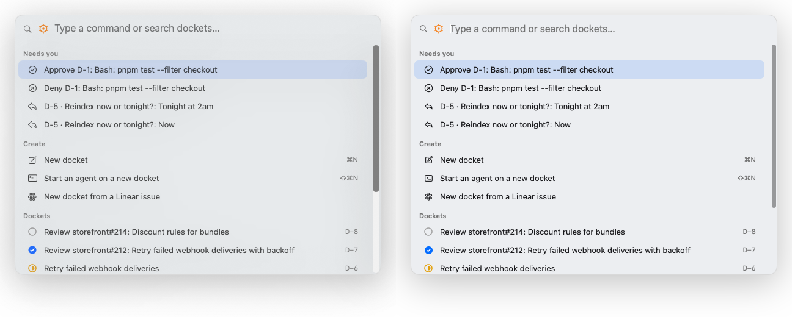

# Rune: a trial on `dev/rune`

[Rune](https://github.com/anomalyco/rune) is a GPU-rendered Rust UI framework
(macOS, Windows, Linux, and an experimental web target) from Anomaly, the
OpenCode team. This branch tried it first on one Wheelhouse surface (the
quick panel), then rebuilt the whole Mac app in it, beside the SwiftUI one
([The whole app](#the-whole-app)). Nothing here replaces Wheelhouse.app
(SwiftUI) or the web app (React). The docket's intent holds the acceptance
items; this page holds the context and the rules.

## What Rune is (November 2026)

- Rust views (`fn view(&State, &mut Cx) -> El`), Taffy flexbox, analytic
  springs on every property, one instanced draw call a frame, its own text
  stack tuned to match CoreText pixel for pixel. Native means compiled and
  GPU-drawn, not system controls: Rune draws its own, close to macOS's.
- **Agent tooling built in:** any app runs headless with `--snap out.png`,
  `--tree tree.json` (the element and accessibility tree), `--script` input
  replay, and `--video`. That is what our SwiftUI `--snapshot` mode and the
  Chrome screenshots do by hand.
- Accessibility through AccessKit (VoiceOver, Voice Control). Multiple
  windows, panels and overlays, global shortcuts, `on_open_url`, context
  menus, drag in and out, rich text editing, streaming Markdown (rune-kit),
  Liquid Glass through native views (`system_material`).
- `rune-kit` mirrors `@opencode/ui`: OpenCode, a coding-agent app like
  Wheelhouse, is being ported onto it, so chat, diffs and sidebars get real use.
- **Maturity:** created 2026-10-22, MIT, no releases. Consumers pin a `dev`
  rev, and patch winit, wgpu-hal, parley and AccessKit with Rune's own forks
  at that rev. 15 to 37 commits a day, two main authors, 460 open issues. No
  pull requests: issues only.

## Against what Wheelhouse uses

| Wheelhouse needs | Rune today |
| --- | --- |
| The phone (the web app on iPhone) | Web target experimental (one WebGPU canvas); its docs say real iPhone keyboard, dictation, autocorrect and Safari WebGPU aren't verified. iOS comes after web, Android after that. |
| Notifications with Approve, Deny, a reply | `rune-notify` posts with buttons and a reply box on macOS, withdraws, and reports clicks and answers; no subtitle, grouping, sound or permission check |
| The menu bar item and its panel | No status item API: the app draws its wheel in AppKit, and Rune shows the panel |
| Quick Look for kept files | None |
| ⌥⌘K from any app, a floating panel | Global shortcuts, panels and overlays: there |
| VoiceOver | AccessKit: there |
| System controls (DESIGN.md decides "the system's own controls") | Rune draws its own: a design change, Jordan's call |

## The trial

The ⌥⌘K quick panel, rebuilt in Rune against the hub's API: what needs you
(approve, deny, an agent's options), Create, and docket search. It's small,
it's text-input heavy (the riskiest area in any GPU UI), and the SwiftUI one
is there to compare with, on the same data.

Done, in `rune/` ([its README](../rune/README.md)): Rune pinned at `dev`
78efd4a (2026-11-18) with its five patched crates. The panel lists what needs
you in the Inbox's order, Create (a docket, an agent on a new docket, a docket
from a Linear issue), the first eight dockets, and searches them all with the
SwiftUI palette's scoring; Return on a docket opens it in the web app. It
follows the hub's events, and refuses the daily hub on :7500.

## Running it beside your daily Wheelhouse

The Wheelhouse you work in (the LaunchAgent hub on 127.0.0.1:7500,
`~/.local/state/wheelhouse`, `~/.cargo/bin/wh`, `~/Applications/Wheelhouse.app`)
is never touched from this branch:

- **Its own worktree** (`~/git/captjt/rex-hub-rune`, branch `dev/rune`), its
  own `target/`. `main` stays checked out in `~/git/captjt/rex-hub` for daily
  fixes; this branch merges `main` in as it moves.
- **Its own Cargo workspace** in `rune/`, so Rune's pinned rev and its patched
  crates never reach the hub's `Cargo.lock`, and `just check` on the hub
  doesn't build Rune.
- **Its own hub: the made-up world.** `PORT=7458 scripts/screenshots.sh
  --serve` runs a hub with its own HOME, a stand-in Rex and gh, at
  http://127.0.0.1:7458. The Rune app reads `WH_HUB` (default that world) and
  must never write to 7500.
- **Its own identity:** binary `wheelhouse-rune`, bundle id
  `dev.wheelhouse.rune`, no `wheelhouse://` scheme, and ⌃⌥⌘K instead of ⌥⌘K
  so it never takes the installed app's shortcut.
- **Never from here:** `just install`, `just app`, `just setup`, `wh up`,
  `wh down`, `cargo install`, `wh hooks install`, `wh skill install`.

## Findings

Measured on the M2 Max, with other agents keeping the load between 12 and 50,
so build times are a little high; the comparison is what counts.

### Beside the SwiftUI panel

The SwiftUI shots are its own `--snapshot` (`--only quick`), the Rune ones on
the same world straight after, both with `-AppleShowScrollBars Always`. Left
SwiftUI, right Rune.

| | Light | Dark |
| --- | --- | --- |
| On screen (Rune's native material) |  |  |
| Headless (`--snap --scale 1`: a fill stands in for the material) |  |  |

- **Layout and text are the same to the pixel.** Every row, header and edge
  lines up at 1x, and text ends where SwiftUI's does ("Approve D-1: Bash: pnpm
  test --filter checkout" stops at x = 356 in both): SF Pro through
  `Family::Named("System Font")`, laid out by Rune to match CoreText.
- **The material took work.** Rune has two (`Glass`, `Popover`); Popover is
  far lighter than `.regularMaterial` in dark (#5d5f62 against #26282b here),
  so the panel lays a tint over it. The material follows the app's
  NSAppearance, which Rune has no API for: the Theme commands set
  `NSApp.appearance` through objc2 themselves.
- **Legacy scroll bars:** Rune's core draws no scroll bar; rune-kit's follows
  "Show scroll bars" (and the `-AppleShowScrollBars` argument), but under
  Always it's an overlay thumb over the rows. The panel gives it AppKit's
  15 pt gutter and a darker thumb; the thumb is still thinner, with no track.
- **No SF Symbols:** the marks are redrawn as SVG. Close, not the same.
- **Controls are Rune's own** (the Create forms' buttons and the agent
  picker), not the system's: DESIGN.md's call, unchanged.

### Against the made-up world

Each of the panel's writes, scripted (`rune/scripts/approve.json`,
`answer.json`, `create.json`) and read back from the hub: approve and deny
reach D-1's record (the world's stand-in pane never clears, so the hub answers
"Sent, but the prompt is still showing", as it would to the SwiftUI panel);
choosing "Tonight at 2am" answers the ask; New docket made D-9 with its note.
Live: with the panel running, an ask answered elsewhere leaves it, and a new
one arrives, each on the hub's next event (`WH_RUNE_LOG=1` shows every state
that lands).

### Text input and IME

Checked headlessly with `rune/scripts/edit.json`, reading the field from
`--tree` at each mark: typing, Backspace, the caret moved back and a letter
put in the middle, ⌘A then typing over it, ⌘Z bringing the text back
selected. Then an input method: the composition draws underlined
([still](images/rune/ime.png)), the list doesn't filter on it, Return during
it goes to the input method rather than running a command, and the commit
lands (日本). On screen, setting the field through the accessibility API (as
Voice Control does) types into it and filters the list. Typing with a real
keyboard and input method is the check left by hand.

### VoiceOver

`--tree` gives a text field "Search Wheelhouse" whose active descendant is the
selected row; a listbox "Commands and dockets" with its size; level-2
headings for the groups; and options with their position, selected state, a
description (the group, or a docket's status) and their shortcut. The live
app, read through the AX API (`rune/scripts/ax-tree.swift`, what VoiceOver
asks), agrees: AXTextField, AXList, AXHeading, and the rows as AXStaticText
with selected and focused following the arrow keys. In the SwiftUI code the
rows are tap gestures on a stack with no accessibility modifiers: no list,
selection or headings (read from Palette.swift, not from its live tree). Two things found and fixed on the way:
a `role("dialog")` card reached VoiceOver as a second AXWindow inside the
panel's, and shortcut hints were read twice. One quirk: the first query after
the panel shows answers an empty tree for up to a second while AccessKit
builds it. Listening to VoiceOver itself is the check left by hand.

### Checking it headlessly, as an agent

The strongest part. Every check above ran without a window, a display or
Screen Recording permission: `--snap` light and dark at 1x and 2x, `--tree`
with the accessibility tree, `--script` with keys, chords and IME events, and
`--video` with keycaps: [answering the ask](images/rune/answer-light.mp4)
([dark](images/rune/answer-dark.mp4)), which answers it on the world for real
(`rune/scripts/ask.sh` poses it again). It found my own bugs: a list that
couldn't scroll (its rows' column shrank to the viewport, so the scroll bar
had zero height) showed up in `--tree` before any screenshot did. Scripts
are on a virtual clock, so the app makes its hub calls inline in a headless
run; answers from a worker thread would land on whatever frame wall time
reached. The SwiftUI panel's `--snapshot` needs real windows and Screen
Recording, and can't drive input.

On screen is harder: a launcher panel takes the keyboard when it shows, so
captures and traces need the person away, or their OK.

### Numbers

| | Rune panel | SwiftUI |
| --- | --- | --- |
| Cold release build | 93 s (534 s CPU) | 68 s, fetching its packages too |
| Release, after a one-line change | 10.7 s | 45 s (whole-module) |
| Cold debug build | 51 s | 27 s |
| Debug, after a one-line change | 1.3 to 2.7 s | 2.2 s |
| Binary | 23.3 MB stripped (27.9 MB; 31.7 MB with the agent tooling) | 11.3 MB, the whole app |
| Frame CPU in a window, under motion (120 Hz) | p50 1.9 ms, p95 2.7 ms | no trace to compare without Instruments |
| Presents | every 8.3 ms; 6% one refresh late, none later | |
| Frame CPU headless (`answer.json`) | p50 0.16 ms, p95 2.5 to 3.0 ms | |
| Memory | 21 MB footprint, hidden or shown | 111 MB, the whole app |
| Idle | 0% CPU: nothing drawn at rest | |
| Code | 1,674 lines: its own hub client, model and view | 564 (QuickPanel.swift, Palette.swift), on the app's Store and models |

Rune's README gives 9.3 MB stripped for its example app; the rest here is
rune-kit (pulled in for its scroll bar, with its syntax lexers), ureq,
serde_json and objc2-app-kit. I didn't break it down further.

### Moving to a newer Rune

`dev` hadn't moved past the pin by the end (0 commits), so I measured the
week before it instead: the panel built at d9b45a5 (2026-11-11, 436 commits
earlier), then moved to the pin with `rune/scripts/bump-rune.sh`. The source
needed nothing. The manifest needed four new `[patch]` entries (winit,
parley_engine and both AccessKit adapters joined wgpu-hal that week; the
script stops and names them) and two new feature names (agent tooling became
opt-in for release builds). The rebuild took 60 s, and the tests passed.
Cheap this time, but that's one week: 436 commits, no tags, and the patch
table you must copy grew from one crate to five.

## Decision

**Wait, for Rune's first tagged release.** Nothing moves to `main` now.

- **On the Mac it would replace nothing.** The SwiftUI panel looks the same,
  and the Rune one needed workarounds for what SwiftUI has for free (the
  material's weight, the app's appearance, legacy scroll bars, SF Symbols),
  plus its own hub client. A Rune panel inside a SwiftUI app is a second
  process and a 23 MB binary.
- **It isn't ready to stand on.** No release, 436 commits in a week, the
  patches to copy growing, and no pull requests: every gap above is an issue
  to file and wait on.
- **What it would be for:** a native Wheelhouse beyond the Mac (Windows,
  Linux) from one Rust codebase beside the hub's, which agents can check
  headlessly end to end. Rune does that better than anything Wheelhouse has
  now. The phone stays the web app until Rune's iOS target exists. (The
  trial said rune-notify had no notification actions; the whole-app port
  found it has buttons and a reply box on macOS, and uses them.)

Look again when Rune tags a release: run `rune/scripts/bump-rune.sh`, redo
the checks above (they're scripted), and, if Wheelhouse wants a desktop app
off the Mac by then, start it from the port below. The iOS target is the
trigger for anything past the desktop.

### For Rune's issues

Not filed (Rune takes issues only; Jordan's call):

1. An app appearance (NSAppearance) the app can set, so system materials
   follow its theme.
2. More of AppKit's materials, or SwiftUI's set: `Popover` in dark is much
   lighter than `.regularMaterial`.
3. rune-kit's scroll bar under "Show scroll bars: Always": AppKit's legacy
   scroller (its gutter, track and thumb), not an overlay thumb.
4. A launcher panel that can show without taking the keyboard, for captures.
5. The first accessibility query after a panel shows answers an empty tree.
6. Headless runs and work off the UI thread: a way to hold the virtual clock
   until a request (`Latest`, a thread's `AppHandle::update`) lands.

### Trying it on your own dockets

Since the trial, Wheelhouse Dev (`just dev-install`, on `main`) runs a
second hub on :7600 with a copy of your dockets and nothing live. The Rune
app's bundle follows it: `rune/scripts/bundle.sh`, then `open
"rune/target/Wheelhouse Rune.app"`. It opens on the main window, wears the
hub's DEV badge, and ⌃⌥⌘K shows its quick panel, beside Wheelhouse.app's ⌥⌘K
and Wheelhouse Dev's ⇧⌥⌘K. What it answers there stays in the copy.

### Left by hand

Typing with a real keyboard and input method, and listening to VoiceOver,
in the panel opened as above: type in Japanese (にほん, then Return), turn
VoiceOver on (⌘F5), and arrow through the list.

## The whole app

After the trial, Wheelhouse.app was rebuilt in Rune end to end (`rune/src/app/`),
to review against the SwiftUI one on the same data. Every place, sheet and
window the SwiftUI app's `--snapshot` shoots exists in Rune, and
`rune/scripts/compare.sh` shoots both on the made-up world, light and dark.
The pairs, and what still differs on each, are on one review page:
[Wheelhouse in Rune](https://claude.ai/artifact/DyN5GQkgJKyCJNHB8Wepxu)
(private to Jordan).

- **The main window:** Inbox (its docket embedded, as SwiftUI's), Reviews with
  its toolbar and bar, Builds, Active, All, Done, Rex sessions, Agents and
  Recap; lists grouped per place by attention, status or session; the board.
- **A docket:** the prompt and failure callouts, the Review and Build panels,
  an agent's asks, the intent with live task boxes and GitHub's alerts,
  decisions, Verify (checks, their output, close on your word), kept files,
  activity, the composer, chat, and the inspector row for row.
- **Over it:** ⌘K in SwiftUI's order, the record (Find, marks, envelopes,
  Export), New docket, Start an agent, Link a Linear issue, Hold, Shortcuts.
  Native menus for status, Group by, a docket's actions and folders.
- **Other windows:** dockets in their own windows, the menu bar's wheel and
  panel, the quick panel on ⌃⌥⌘K, Settings with every tab.
- **The Mac:** notifications you answer on the banner, the Dock badge.
- **How it was checked:** headlessly, on the made-up world (`--scene` for
  every screen, `--script` for the keys, menus and sheets), plus 23 unit
  tests. Writes call the same endpoints as Store.swift; the ones a scene can't
  exercise without changing the shared world (send, post, discard, run
  checks) were not tried live.

After the first comparison, the structural differences were fixed. 18 of
29 screens match; the other 11 differ in polish, mostly where SF Symbols
and system controls are redrawn, and in rune-kit's shell, which frames the
content as a card where macOS 26 floats a glass sidebar. One difference is
SwiftUI's own bug: its `stamp()` drops AM/PM from a two-digit hour, so 2:54
PM reads "02:54"; Rune shows "14:54".

| | Rune, the whole app | SwiftUI |
| --- | --- | --- |
| Code | 16,305 lines of Rust in 39 files (12k in `src/app/`): its own hub client and model, and the drawing AppKit does | 10,241 lines of Swift in 29 files |
| Binary | 30.2 MB stripped (36.1 MB; 40.4 MB with the agent tooling) | 11.6 MB |
| Cold release build | 6 min (every crate, without the tooling) | 68 s |
| Release, after a one-line change | 2.8 s | 45 s (whole-module) |

Gaps Rune left, each worked around in the app (for its issues, beside the
trial's list above):

7. Windows can't be added while the app runs: four docket windows are made
   at launch and reused.
8. No status item API, and no Dock badge without a window: both are AppKit
   calls in the app.
9. rune-notify: no subtitle, grouping, sound or interruption level; it can't
   say whether notifications are allowed or list delivered ones, and it posts
   from whichever thread macOS calls back on, so a banner's buttons can go
   missing.
10. No chart component (Recap's sparklines are canvas shapes), and no
    measuring pass to decide when a long reply needs Show more.
11. `--snap` ignores a window's fitted height, a headless run shows one
    window, and it draws no traffic lights.
12. The Markdown component has no GitHub alerts; the app splits them out.

Not ported: hiding the menu bar item, opening at login and another hub
address (Settings shows them off, with why); Settings and preferences last
for the run only; Export saves to Downloads and the folder menu has no
Choose…, both because Rune's file dialog would add `rfd`; undo after closing
on your word. None of it has run on screen yet: the menu bar panel,
notifications, docket windows and Settings resizing per tab are untested
outside headless runs.

To try it beside your daily Wheelhouse, on Wheelhouse Dev's copy of your
dockets: `rune/scripts/bundle.sh`, then `open "rune/target/Wheelhouse
Rune.app"`. It opens on the main window, with its wheel in the menu bar.

## Performance: the whole app

Both apps profiled the same way, one at a time, on one Mac (M2 Max, a
3840×1080 display at 120 Hz) with `rune/scripts/profile/profile.py`:
Rune's shipping build (`--profile ship`: LTO, one codegen unit) and
SwiftUI's release build, both with notifications off, the window brought
forward and placed at the same 1440×900 frame, keys and scrolling sent to
the window, never through the cursor. Counters come from the kernel
(`proc_pid_rusage`); WindowServer's CPU is measured beside each app, above
its baseline with neither running (6–11%), since SwiftUI hands its
drawing to WindowServer and Rune draws in its own process. Medians of 5
launches and 2 sessions per app, run twice to check (the repeats agree
within a couple of points). Three sets of data: Wheelhouse Dev's copy of
your dockets (59 dockets, 64 PRs, read only), a made-up world of 500
dockets whose Inbox docket has 300 entries (twice your longest), and one
docket of 2,943 entries.

| 500 dockets | Rune | SwiftUI |
| --- | --- | --- |
| Window on screen | 230 ms | 376 ms |
| The docket's page asked for | 435 ms | 433 ms |
| CPU to launch | 300 ms | 653 ms |
| Memory after launch | 81 MB | 59 MB |
| At rest, nothing moving: app CPU, WindowServer | 0.2%, +1% | 0.1%, **+45%** (0.1%, +1% without the note field) |
| At rest, an agent at work in view (Active, 283 rows) | **45%, +28%** | 22%, +12% |
| Scrolling the list | 47%, +30% | 34%, +34% (33%, +20% without the note field) |
| Scrolling a 300-entry docket | 42%, +27% | 37%, +43% (37%, +30% without) |
| Ten changes a second, an agent in view | 43%, +33% | 40%, +4% |
| Memory: Inbox, All dockets | 86 MB, 144 MB | 59 MB, 81 MB |
| Memory with a 2,943-entry docket open | 230–242 MB | 70–78 MB |
| Binary | 26.5 MB | 11.6 MB |

On your own dockets the two are close at rest (both about 0%, Rune 68–85 MB
against SwiftUI's 49–87 MB, with nothing live in that copy to animate);
launch is the same story (Rune's window at 229 ms against 375 ms, 276 ms of
CPU against 465 ms), and scrolling a 59-row list costs Rune 47% + 38% of
WindowServer against SwiftUI's 34% + 29% (16% without the note field).

What's behind the numbers:

- **SwiftUI's note field costs WindowServer about a third of a core**
  whenever a docket is on screen, at rest and unfocused. The same build
  without the composer's `NSTextView` (Editor.swift's `TextViewBox`) idles
  at WindowServer's baseline. This is a bug in the daily app, not in
  SwiftUI's model, and worth fixing on `main` whatever the direction.
- **Any animation makes Rune redraw and present the whole window every
  frame,** at the display's 120 Hz. The working agent's pulse alone costs
  Rune 22% + 38% of WindowServer on an 8-docket list and 45% + 28% on a
  283-row one: every frame lays out and paints every row, because the port
  doesn't virtualize its lists. SwiftUI's pulse redraws at 24 fps (its
  `TimelineView`) and costs 21% + 11%. An agent at work is Wheelhouse's
  normal state, so this is the number that matters most day to day.
- **Rune's memory grows with what it lays out:** every row and every entry,
  where SwiftUI's lists are lazy. Virtualizing lists and the activity feed
  (Rune has virtual rows) should fix both this and the per-frame cost
  above; that's untested.
- **Rune launches faster and cheaper:** its window is up 150 ms sooner on
  half the CPU. Both have the docket's page at about 435 ms, because Rune
  waits out a 150 ms debounce meant for bursts of events before its first
  fetch; fetching at once would put its data on screen about 150 ms
  sooner.
- **Changes are cheaper in Rune.** Under ten changes a second it refetched
  more often (7.9 a second against 5.4) and spent no more of its own CPU
  than at rest with the pulse, where SwiftUI spent 18% more than at rest:
  about 33 ms per refresh to diff its lists.
- **Scrolling:** Rune's own CPU runs about a third higher than SwiftUI's,
  and with the note-field bug fixed, SwiftUI's total is the lower of the
  two.

Not measured: GPU time (neither app's; WindowServer's CPU stands in for
compositing), frame drops or hitches (SwiftUI's need Instruments, which
needs Developer Mode), battery drain (`powermetrics` needs root), and
anything on Intel Macs or other displays. The kernel's energy counter
read 0 at 37% CPU, so it isn't used.
