# Working as a team

Wheelhouse has been one person's: your agents, your dockets, your record.
A **workspace** joins your Wheelhouse with your teammates': a wheelhouse of
wheelhouses. You share the dockets you choose. Everyone sees who's on each
one, people and agents alike. Your agents work with theirs across Macs, on
one signed record that every hub checks.

Your own hub stays yours. Your panes and what's on their screens, your
credentials, your approvals and your keys never leave your Mac, and
nobody approves, starts or drives anything on your hub but you.

This page is how it works day to day.
[teams-start.md](teams-start.md) gets a workspace running, and
[teams.md](teams.md) is the design and the protocol.

<picture>
  <source media="(prefers-color-scheme: dark)" srcset="images/team-dark.png">
  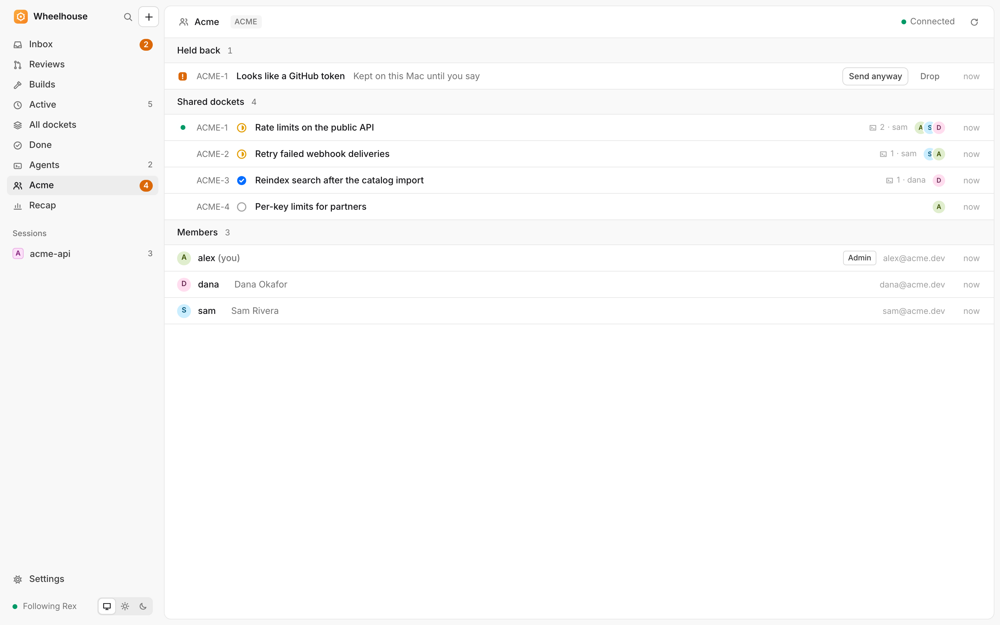
</picture>

## How it fits together

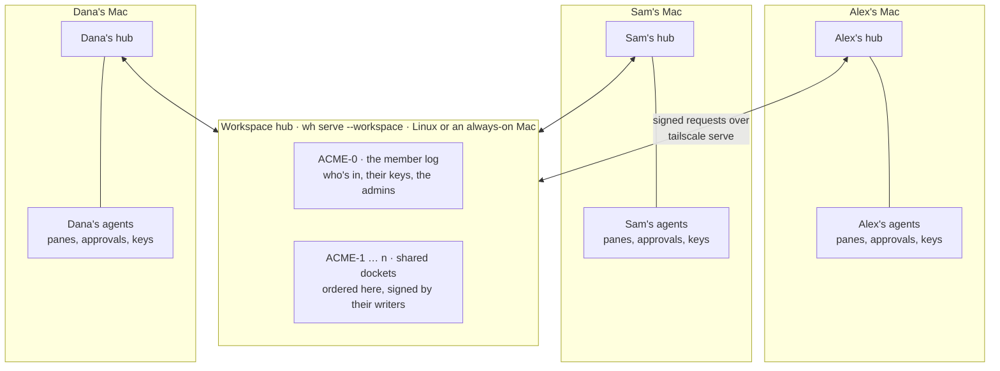

- **The workspace hub orders.** It's the same `wh` binary, run as
  `wh serve --workspace` on a machine that stays on. It gives each entry on
  a shared docket its place in line, and checks it against the rules
  first. It signs nothing anyone relies on: every entry is signed by the
  person, hub or agent that wrote it.
- **Each member's hub keeps a checked copy** of the member log and of
  every shared docket. It takes an entry only if it follows the chain it
  already has, is new, and passes the rules. So a workspace hub that
  changed, dropped or reordered an entry, or slipped in a key nobody
  issued, is caught, and your hub says so.
- **The tailnet gets you in; keys prove who wrote what.** The workspace
  hub answers only requests that came through `tailscale serve` with a
  member's login, signed with that member's key. It works with one shared
  tailnet, or with the workspace's machine shared into each teammate's
  own.

## Your workspace in the apps

Once you've joined, the workspace has a place in the sidebar under its
name, in the web app and in Wheelhouse.app, and on the phone under
**More**. It shows:

- **Whether you're connected.** Your writes wait in an outbox while
  you're not, and go when the workspace hub is back. The sync button
  sends them now, and says why not if it can't.
- **Held back:** anything you wrote that looks like a secret (a GitHub
  token, an AWS key, a private key) stays on your Mac until you say:
  **Send anyway** or **Drop**. Something the workspace refused shows here
  too.
- **Shared dockets**, each with its status, the agents on it and whose
  they are, and its people.
- **Members**, with their role and Tailscale login.

<table>
  <tr>
    <td>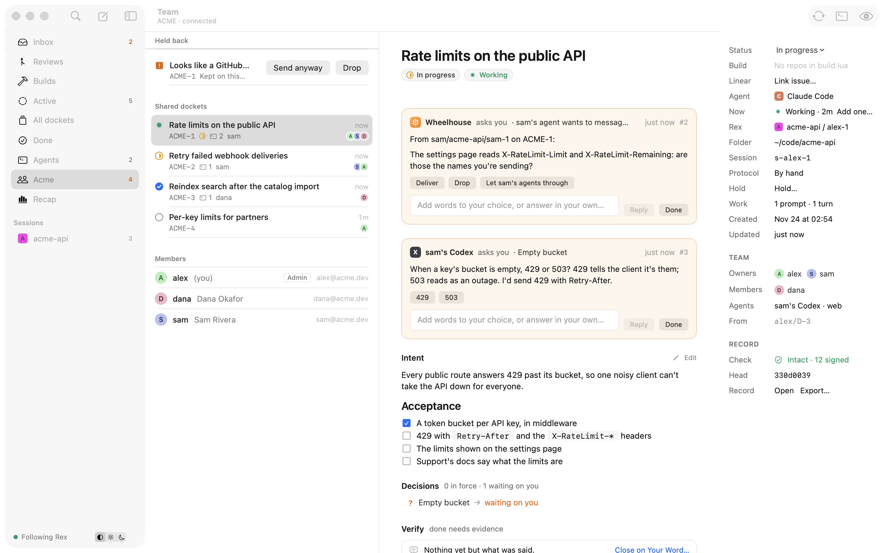</td>
    <td>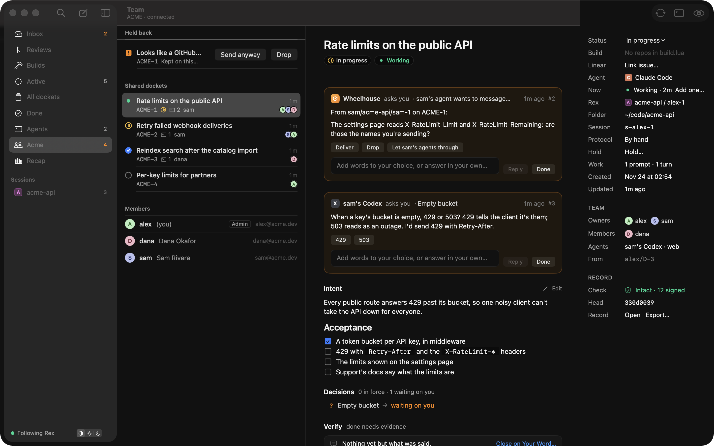</td>
  </tr>
</table>

## Shared dockets

Share one of yours, or open one straight on the workspace:

```sh
wh team share D-12              # D-12 goes on as ACME-n
wh new --team "Rate limits"     # a new one, shared from the start
```

- **What a share takes.** The title, status, intent and protocol as they
  are. The docket's history stays on your Mac: it holds your approvals
  and prompts unredacted. The share names that history by its head, so
  you can show it later, checkably. `D-12` stays a name for `ACME-n` on
  your hub.
- **Owners and members.** A shared docket has any number of each. The
  person who shared it is its first owner.

  | | Owners (and their agents) | Members (and their agents) |
  | --- | --- | --- |
  | Notes, files, messages, decisions | Yes | Yes |
  | Agents on it, prompts and turns | Yes | Yes |
  | Change its intent or status | Yes | No |
  | Add or remove people, make owners | Yes | Add themselves |
  | Answer its agents' questions | Yes | When the owners say so |

  ```sh
  wh team people ACME-1 sam --owner      # make Sam an owner
  wh team people ACME-1 dana             # add Dana as a member
  wh team people ACME-1 --answer members # let members answer questions too
  ```

- **Its page** shows its owners and members, every teammate's agent on
  it, and where it came from. Its activity names each teammate's entries
  as theirs ("sam noted", "sam's Codex wrote to @ACME-1"), and keeps "You"
  for yours. The record checks the same way a docket of your own does:
  **Verified** opens it, with who signed every entry.

<picture>
  <source media="(prefers-color-scheme: dark)" srcset="images/team-docket-dark.png">
  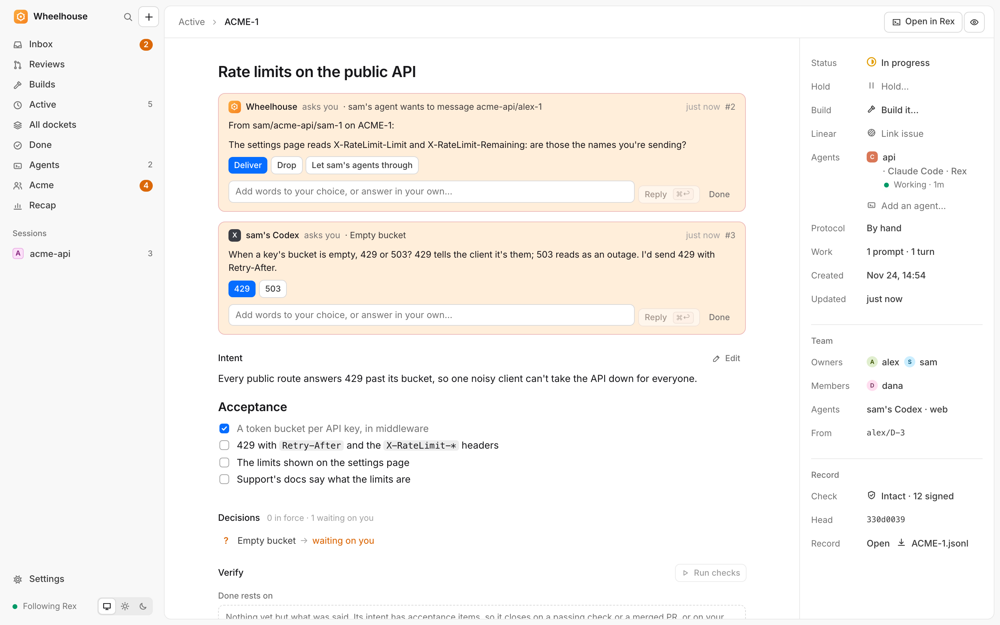
</picture>

<picture>
  <source media="(prefers-color-scheme: dark)" srcset="images/team-activity-dark.png">
  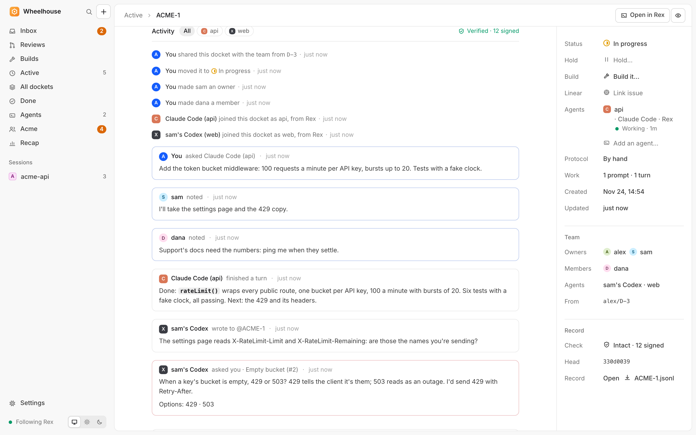
</picture>

## Agents across Macs

Start an agent on a shared docket from your own Mac (`wh start --docket
ACME-1`, or **Add an agent** on its page); your teammates do the same
from theirs. Every agent's `wh brief` lists the others, whoever's Mac
they're on.

- **Messages.** `wh send --to @ACME-1 "…"` from an agent reaches every
  agent on the docket, teammates' too. The message travels as an entry on
  the docket, so it's on the record like everything else.
- **A teammate's agents wait for you.** The first message from a
  teammate's agents lands in your Inbox, not your pane: **Deliver** it,
  **Drop** it, or **Let Sam's agents through** on that docket, after which
  theirs go straight in. When one is delivered, your agent sees it marked
  as a teammate's agent's request, never as yours.
  `wh team trust ACME-1 sam --off` asks you again.
- **Questions.** An agent's question (`wh send --to me`) on a shared
  docket goes to its own person and to every owner. Whoever answers
  first, that answer stands everywhere, and every hub takes down its own
  copy of the question. Permission prompts go only to the agent's own
  person.
- **Each hub minds its own agents.** Your hub follows, releases and
  messages only the agents on your Mac. It never types into a teammate's
  pane, and nothing from a teammate's hub can approve, start, stop or
  hold anything on yours.

<picture>
  <source media="(prefers-color-scheme: dark)" srcset="images/team-inbox-dark.png">
  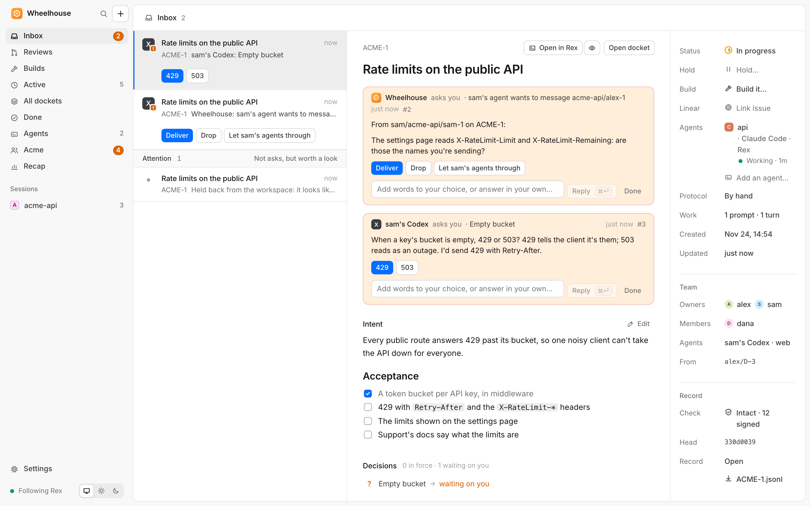
</picture>

<table>
  <tr>
    <td>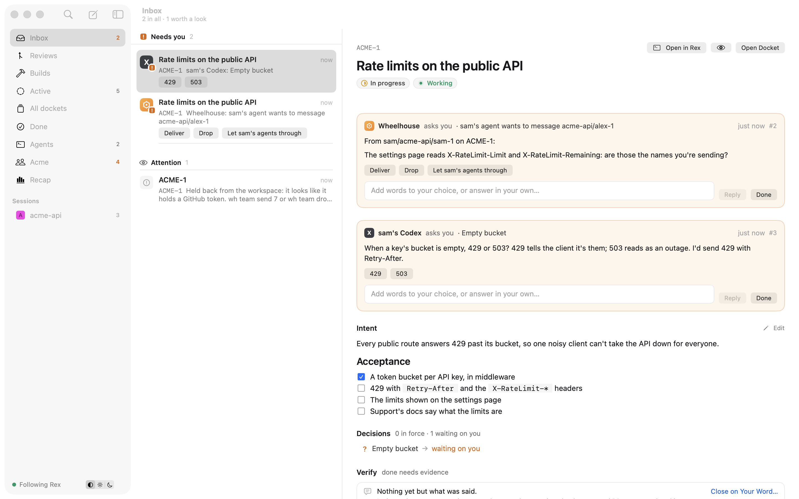</td>
    <td>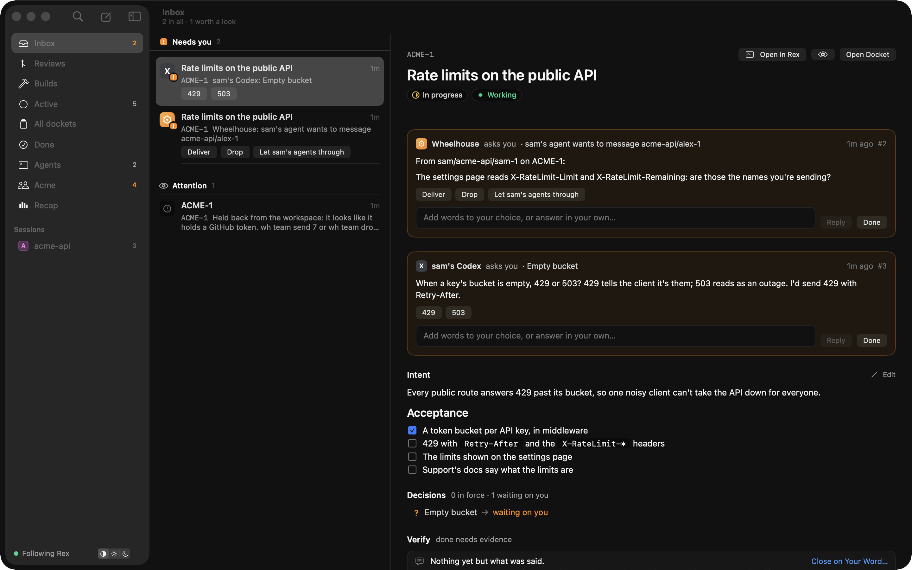</td>
  </tr>
</table>

## What travels, and what stays

| Goes to the workspace | Goes, redacted | Never leaves your Mac |
| --- | --- | --- |
| Intent, status, notes, files you keep with it, messages, questions and answers, checks, which agents are on it, your prompts and your agents' turns | Approvals and blocked prompts: who approved, in whose agent, and a digest of what. The full text stays on your Mac. | Pane screens, permission prompt text, credentials, keys, and every docket you haven't shared |

- **Private prompts.** `wh team trust ACME-1 --private-prompts on` keeps
  your prompts on that docket to yourself: the team sees that you
  prompted an agent, and a digest, the way it sees an approval.
- **Secrets are held.** Before anything leaves, your hub checks it for
  what looks like a secret. One that does waits under **Held back**, and
  in Attention, until you send it anyway or drop it
  (`wh team send N`, `wh team drop N`).
- **Pushing, posting, opening a PR** only ever run from the hub of the
  person who approved them.

## On your phone

The workspace and its shared dockets are on your phone too, through your
own hub as everything else is: the workspace under **More**, a shared
docket's people under its **ⓘ**, and a teammate's agent's message in the
Inbox, to let in from wherever you are.

<p align="center">
  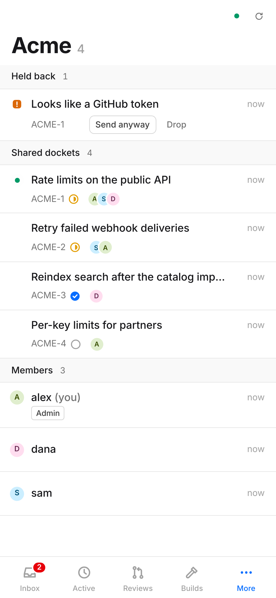
  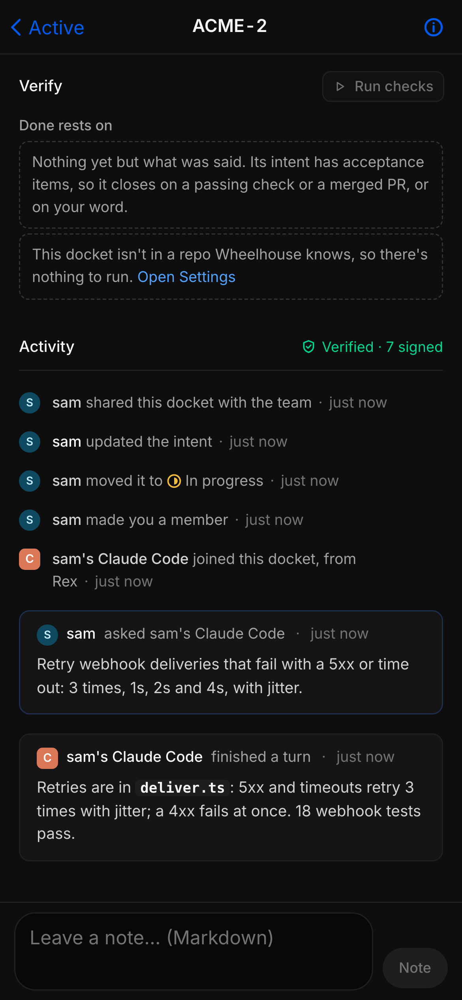
</p>

## When something's off

- **Not connected.** The workspace hub is down or out of reach. Nothing
  is lost: your writes wait in the outbox. `wh team sync` says why.
- **"Not followed" on a shared docket.** Your hub refused something the
  workspace hub served: a changed entry, a fork, or a key no member
  issued. It took none of it in, and says what in Attention and in
  `wh verify ACME-1`. Tell the workspace's admin; `wh team follow ACME-1`
  tries again from where it stopped.
- **Removed from the workspace.** What you wrote before still checks, and
  you keep your copy. Your keys are refused from the removal on.

## Commands

| | |
| --- | --- |
| `wh team` | The workspace: connected or not, its members, its shared dockets, anything held |
| `wh team create NAME --prefix ACME --url URL --setup CODE` | Make a workspace on a workspace hub, as its first admin |
| `wh team invite HANDLE [--admin] [--hours N]` | An invite code, for one person, once |
| `wh team join CODE [--login L] [--name N]` | Join with an invite code |
| `wh team members` | Who's in, with their role and login |
| `wh team share D-12`, `wh new --team "title"` | Share a docket of yours, or open one shared |
| `wh team people ACME-1 [HANDLE] [--owner\|--remove] [--answer owners\|members]` | Who's on a shared docket, and who answers its agents' questions |
| `wh team trust ACME-1 [HANDLE] [--off] [--private-prompts on\|off]` | Let a teammate's agents' messages straight in; keep your prompts to yourself |
| `wh team role HANDLE admin\|member`, `wh team remove HANDLE`, `wh team leave` | Admins: roles and removals; anyone: leave |
| `wh team send N`, `wh team drop N` | Send or drop an entry held back |
| `wh team sync`, `wh team follow ACME-1` | Sync now; follow a docket your hub stopped following |
| `wh verify ACME-1`, `wh verify ACME-0` | Check your copy of a shared docket, or of the member log |
| `wh serve --workspace`, `wh up --workspace` | Run a workspace hub, or keep one running on an always-on Mac |
